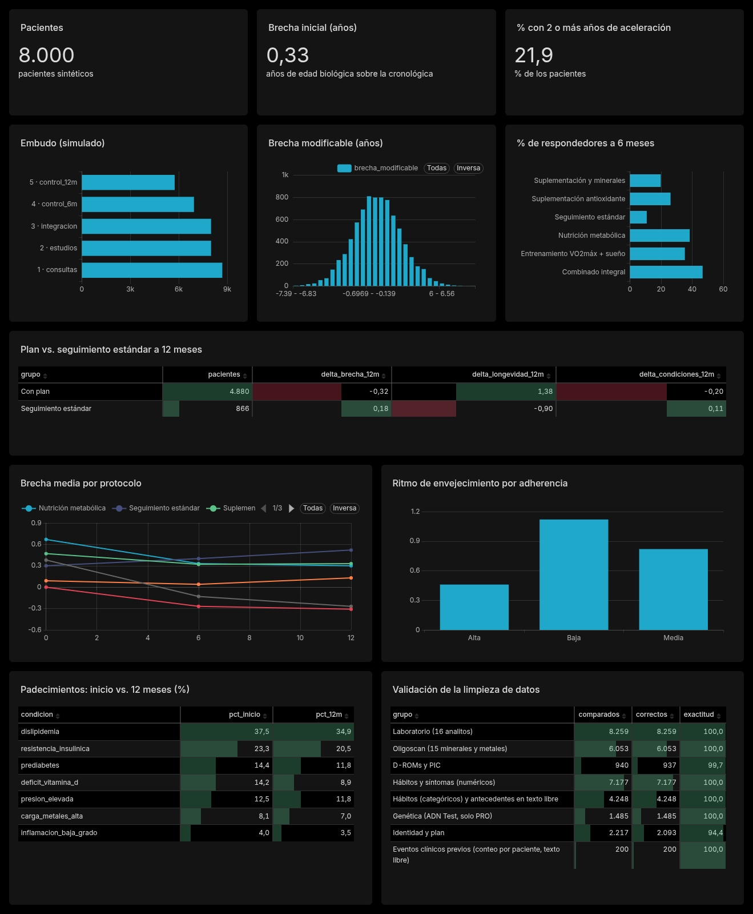

# Estudio de Datos de Longevidad

> **Esto es una demostración de método, no un hallazgo.** Todos los datos son sintéticos y los efectos de los protocolos son parámetros de mi simulador. Armé este proyecto para mostrar *cómo* trabajaría como analista de datos en una clínica de medicina preventiva —del dato sucio a la decisión—, no para probar que un tratamiento funcione. Más pacientes simulados no agregan evidencia: solo vuelven más realista la escala del trabajo.

Lo hice por iniciativa propia, a partir del tipo de trabajo analítico que hace una clínica de longevidad. Soy Nahir Ramón Chambi, analista de datos en Mendoza (SQL, BigQuery, dbt, Python), y este es mi proyecto de portfolio.

## La pregunta
¿Cómo se ve, con datos ordenados, la diferencia entre un plan preventivo y un seguimiento estándar? ¿A qué pacientes conviene priorizar y dónde se pierde el resultado? En [`docs/DECISIONES.md`](docs/DECISIONES.md) traduje cada indicador a una decisión posible y a cómo se vería si estuviera mal.

## Qué hice
1. **Cohorte sintética de 8.000 pacientes** con visitas a 0, 6 y 12 meses (20.687 visitas). Cada persona es distinta: hábitos, genética (solo programa PRO), antecedentes familiares e intolerancias, un perfil propio por dominio (metabolismo, inflamación, cardiovascular, minerales, rendimiento), adherencia propia y una **respuesta individual al protocolo**: algunos responden mucho, otros poco y alrededor del 10 % casi nada. Hay también eventos intercurrentes en algún control y estacionalidad de la vitamina D.
2. **Datos crudos y sucios, sobre una muestra de 200 pacientes** (10 Excel y 20 PDF con fechas ambiguas, DNI en formatos distintos, decimales con coma, unidades mezcladas y duplicados). Los limpié con Python (pandas, pdfplumber) y los validé contra el origen: 100 % en la mayoría de los grupos y 94,4 % en identidad y plan. Es una validación optimista, porque los errores los inyecté yo. El análisis posterior usa la cohorte completa, sin pasar por ese circuito.
3. **Edad biológica** a partir de biomarcadores, separada en parte genética fija y parte modificable. Sumé un Score de Longevidad, segmentos (K-Means) y hojas de ruta.
4. **Modelo en estrella** (`dim_*`, `fact_*`) en CSV, Excel y SQLite, con 8 consultas SQL de indicadores que verifiqué contra el tablero. El diccionario está en [`docs/DICCIONARIO_DATOS.md`](docs/DICCIONARIO_DATOS.md).
5. **Tablero en Apache Superset sobre Linux**, creado por código a través de su API REST (`superset/`), sin armar nada a mano.

## Resultados de control (datos sintéticos)
| Indicador | Valor |
|---|---|
| Pacientes / visitas | 8.000 / 20.687 |
| Brecha inicial media (edad biológica − cronológica) | 0,33 años |
| Pacientes con 2 o más años de aceleración | 21,9 % |
| Δ brecha a 12 meses, plan vs. estándar | −0,32 (n=4.880) vs. +0,18 (n=866) |
| Respondedores a 6 meses, plan vs. estándar | 34,0 % vs. 10,8 % |
| Con plan y adherencia alta, sin mejora de la brecha a 12 meses | 19,5 % |

## Capturas


## Cómo correrlo
Los datos no se suben al repositorio: se generan con una semilla fija (el proceso tarda unos 2 minutos).
```
python3 -m venv .venv-datos && . .venv-datos/bin/activate
pip install -r requirements.txt
./ejecutar_todo.sh              # cohorte, fuentes sucias, limpieza, modelos, SQLite y pruebas
cd superset
./instalar.sh                   # una sola vez
./iniciar.sh                    # Superset en http://localhost:8088
./cargar_tablero.sh             # en otra terminal: crea conexión, datasets, gráficos y tablero
```
Detalles y errores comunes en [`superset/README_SUPERSET.md`](superset/README_SUPERSET.md). Comparé otras herramientas que corren en Linux en [`docs/ALTERNATIVAS_LINUX.md`](docs/ALTERNATIVAS_LINUX.md).

## Contexto público de Argentina
Lo uso para dimensionar el problema, no para probar demanda. La esperanza de vida al nacer en 2019 era de 80,2 años en mujeres y 74,4 en hombres, y el peso de los mayores de 75 entre los mayores de 60 pasó de 23,7 % a 30,3 % ([INDEC](https://www.indec.gob.ar/ftp/cuadros/poblacion/dosier_personas_mayores_2026.pdf)). El Censo 2022 registró 53 mayores de 65 cada 100 menores de 15, contra 40 en el censo anterior ([Infobae](https://www.infobae.com/politica/2023/11/29/censo-2022-el-indice-de-envejecimiento-registro-el-aumento-mas-alto-en-los-ultimos-50-anos/)). Cerca del 18 % del gasto en salud es de bolsillo, dato de 2015 ([Fundar](https://fund.ar/wp-content/uploads/2022/05/Fundar-El_gasto_de_bolsillo_en_salud_como_indicador_clave.pdf)). El embudo y la retención de mi tablero son simulados.

## Límites que prefiero decir yo
- Los efectos de los protocolos son parámetros del simulador: ilustran el método, no prueban eficacia. Que el plan "gane" es consecuencia de cómo lo programé.
- La edad biológica sale de biomarcadores; no es un reloj epigenético. El modelo es débil (el Reloj A tiene correlación 0,31) y los segmentos se separan poco (silhouette 0,18).
- La limpieza se probó sobre una muestra de 200 pacientes con errores que inyecté yo; con datos reales la exactitud sería menor.
- PIC y Oligoscan son marcadores de posición: formatos, valores y genotipos ficticios.
- Con datos reales haría falta consentimiento y acceso restringido (Ley 25.326). Es apoyo a la decisión médica, no diagnóstico.

## Stack
Python (pandas, pdfplumber, scikit-learn), SQL/SQLite con modelo en estrella, Apache Superset (API REST), Linux Debian. Elegí herramientas gratuitas a propósito: es el stack que puede sostener una startup en etapa temprana.
